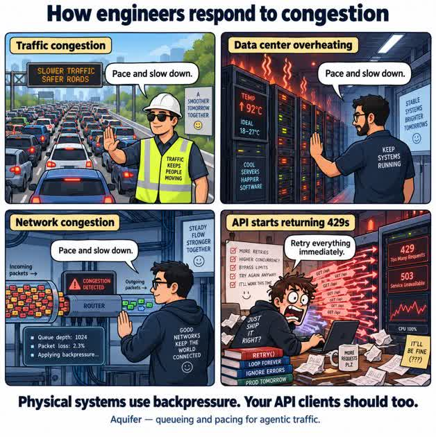
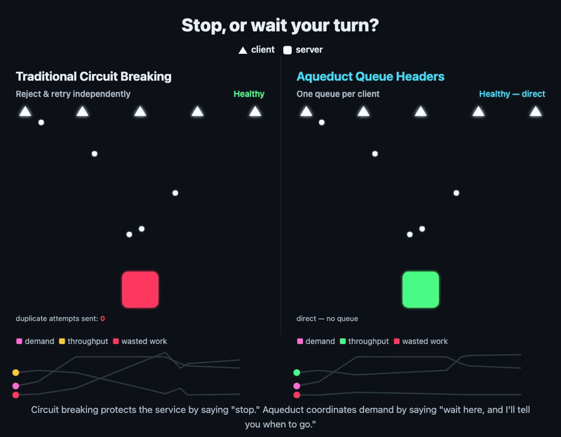

# Aquifer



A durable queue that paces traffic into a service at the rate it can take. Put it in front of a GPU, a rate-limited third-party API or your own backend: when a burst arrives faster than the target can handle, Aquifer holds the excess on disk instead of letting callers retry into it, and releases it as fast as the target says it can go.

- **Retry storm mitigation.** Callers wait in a durable queue instead of hammering a struggling service with retries, and the queue drains as capacity comes back.
- **Fairness.** Every tenant gets its own queue, so one noisy customer or runaway agent can't starve the rest.
- **Results however the caller wants them:** on the same connection (synchronous), over a WebSocket that replays anything missed after a reconnect, or by durable webhook.


## Why not Envoy or Hookdeck?

Envoy's circuit breaking protects an overloaded service by rejecting the excess. A rejected request is gone, so every client retries on its own and they all compete for whatever capacity frees up next. Circuit breaking says "stop." Aquifer says "wait here, and I'll tell you when to go."



Hookdeck queues inbound webhooks as a hosted service, billed by usage. Aquifer is open source and runs on your own machines, so scaling it costs only the machines you add, and it paces outbound API calls, agent tool calls and WebSocket sessions too.

You can run it with both: Envoy in front as the gateway, Aquifer behind it holding the work, and Hookdeck delivering its webhooks into Aquifer.

## Results

- **GPU work wasted on retries: 96.5% direct, 22% through Aquifer.** With load ramped far past a vLLM server's capacity, callers that timed out and retried left the GPU generating answers nobody was waiting for. Through Aquifer, capped at vLLM's real concurrency, vLLM's own queue stayed at 0 instead of peaking at 18,079 ([details](https://rjpruitt16.github.io/aquifer/benchmarks/#10-gpu-retry-tax-measured-in-tokens-runpodvllm)).
- **Pacing from the GPU's own signal:** reading the load report vLLM already sends, Aquifer cut the peak backend queue from 449 waiting requests to 8.
- **AI agents sharing a GPU, CI runners and a sandbox:** during bursts, compared with calling directly and retrying, the smallest tenants' p99 fell from 245 s to 149 s and each workflow needed 10 requests instead of 17.
- **A 10× spike accepted without an error:** 3,000 jobs in 30 seconds, every one accepted, p99 166 ms to accept. That measures intake; the jobs then complete at the target's pace.

Methods and caveats: [benchmarks](https://rjpruitt16.github.io/aquifer/benchmarks/), and the end-to-end tests in front of Hatchet, vLLM and multi-agent workflows in [aqueduct-benchmarks](https://github.com/rjpruitt16/aqueduct-benchmarks).

## Quick start

```bash
go install github.com/rjpruitt16/aquifer/cmd/aquifer@latest
aquifer
```

Send it a job and watch it go through the line:

```bash
curl -s localhost:8080/jobs -H 'Content-Type: application/json' -d '{
  "user_id": "me", "idempotent_key": "first-job",
  "url": "https://httpbin.org/post", "method": "POST", "body": "{\"hello\":\"aquifer\"}"
}'
# {"job_id":"c22c473d…","status":"queued"}

curl -N localhost:8080/jobs/<job_id>/stream
# event: queued
# event: completed   (data carries the target API's response_status and body)
```

Or with Docker Compose:

```bash
docker compose build --pull --no-cache
docker compose up --detach
curl http://127.0.0.1:8080/ready
```

Fly.io, AWS and multi-node setups are in the [quick start guide](https://rjpruitt16.github.io/aquifer/quick-start/). Release binaries for Linux and macOS are on every [GitHub release](https://github.com/rjpruitt16/aquifer/releases).

Keep Aquifer on a private network behind a gateway you trust: it sends real HTTP requests to the URLs it's given, so it must never take them from untrusted callers. See [Why Aquifer](https://rjpruitt16.github.io/aquifer/) for where it sits.

## Durability and running more than one node

Each accepted job is written to the local disk of the node that accepted it (Pebble by default).

- **By default, writes are synced every 100 ms.** Aquifer answers before a write reaches disk, so a crash loses the jobs accepted since the last completed sync: about 100 ms of intake normally, more when the disk is slow. New jobs get `429` once that gap passes 1 second. For no loss of acknowledged jobs, set `AQUIFER_PEBBLE_FLUSH_INTERVAL_MS=0`: every write waits for its own fsync, and 30 of 30 jobs survived a `kill -9` mid-drain. It costs throughput: on a Fly machine, about 150 jobs/s end to end instead of 700.
- **A restarted node picks its queue back up** from its volume and dispatches it again. Delivery is at least once, so make the target and your webhook handler idempotent on the job's key.
- **Queued jobs are not replicated.** If a node's disk is lost, the jobs queued on it are lost with it. Where that matters, keep the original request until its result arrives, and resubmit with the same `idempotent_key` if it doesn't.
- **More than one node:** nodes are independent, each with its own queue and pacing. With [cluster routing](https://rjpruitt16.github.io/aquifer/api/#regional-cluster-routing) on, any node accepts a request and forwards it to that user's owner; when an owner is unreachable, its users' new requests go to the next node. Pacing is per node, so several nodes in front of one target multiply the rate it sees: either give each protected target its own node, or have the target divide its rate among them: Aquifer sends `X-Aqueduct-Node-Id`, so it can count the nodes ([Partitioning](https://rjpruitt16.github.io/aquifer/partitioning/)).

## Why not SQS or Redis plus a rate-limited worker?

You can build this yourself, and in the multi-agent benchmark a carefully built Redis queue and dispatcher matched Aquifer's latency. What Aquifer gives you without writing that code:

- a queue per tenant, with fair admission when the backlog fills;
- a pace the target sets live, through `X-Aqueduct-*` response headers or vLLM's own load report, instead of a fixed worker rate;
- `POST /proxy`, which calls the target directly when it has room and falls back to the queue on the same connection;
- idempotency keys, and results by stream, WebSocket or webhook.

In that benchmark's bursts, Aquifer also drew about 5× fewer refusals from the downstream CI service than the hand-built dispatcher, because it paced to the limits CI advertised.

## Documentation

**[rjpruitt16.github.io/aquifer](https://rjpruitt16.github.io/aquifer/)** covers pacing, streaming, pools, deployment, the full API and every setting.

For coding agents: [`llms.txt`](https://rjpruitt16.github.io/aquifer/llms.txt) lists every page as plain Markdown, so an agent can fetch only what it needs. To try Aquifer on your own workload, point your agent at the [Aquifer pilot skill](skills/aquifer-pilot/SKILL.md): it runs Aquifer in a shadow run on a branch and shows you the numbers.

The same pages are in this repository: [docs/pages](docs/pages), [API.md](API.md), [CONFIGURATION.md](CONFIGURATION.md), [ADAPTERS.md](ADAPTERS.md), [DRAIN_MODE.md](DRAIN_MODE.md), [REGISTRATION.md](REGISTRATION.md) and [benchmark.md](benchmark.md).

## Writing

- [Eliminate GPU Waste by Cutting the Retry Tax](https://rahmipruitt.me/content/gpu-retry-tax/)
- [GitHub Outages Show the Limits of Reactive Scaling](https://rahmipruitt.me/content/github-outage-reactive-scaling/)

## License

[Apache License 2.0](LICENSE). Releases before this change were MIT.

Built by [Rahmi Pruitt](https://rahmipruitt.me). Open to AI infra consulting, founding engineer, and contract work.
