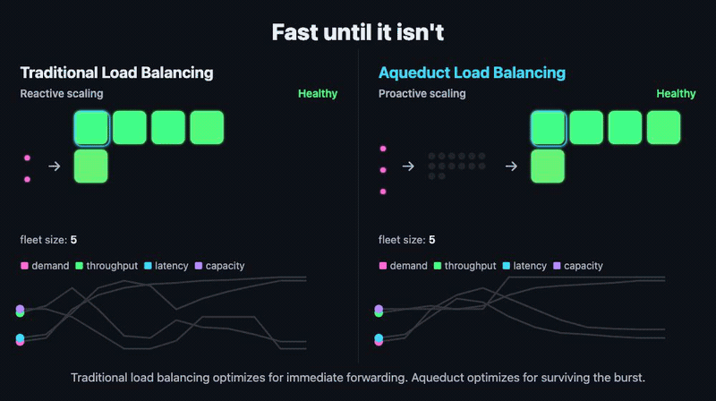

# Aquifer

A self-hosted load balancer for agent and API traffic. When a burst arrives faster than your backend, a GPU or a third-party API can take it, Aquifer holds the excess on disk and lets it through at the rate the target says it can handle.

- **Retry storm mitigation.** Callers wait in a durable queue instead of hammering a struggling service with retries, and the queue drains as capacity comes back.
- **Fairness.** Every tenant gets its own queue, so one noisy customer or runaway agent can't starve the rest.
- **Results however the caller wants them:** on the same connection (synchronous), over a WebSocket that replays anything missed after a reconnect, or by durable webhook.



## Why not Envoy or Hookdeck?

Envoy's circuit breaking protects an overloaded service by rejecting the excess. A rejected request is gone, so every client retries on its own and they all compete for whatever capacity frees up next. Circuit breaking says "stop." Aquifer says "wait here, and I'll tell you when to go."


Hookdeck queues inbound webhooks as a hosted service, billed by usage. Aquifer is open source and runs on your own machines, so scaling it costs only the machines you add, and it paces outbound API calls, agent tool calls and WebSocket sessions too.

You can run it with both: Envoy in front as the gateway, Aquifer behind it holding the work, and Hookdeck delivering its webhooks into Aquifer.

## Results

- **10× traffic spikes absorbed with zero failures**, with clean `429`s once a sustained overload fills the queue.
- **A real GPU under load:** reading vLLM's own load signal, Aquifer cut the peak backend queue from 449 waiting requests to 8.
- **AI agents sharing a GPU, CI runners and a sandbox:** during bursts, compared with calling directly and retrying, the smallest tenants' p99 fell from 245 s to 149 s and each workflow needed 10 requests instead of 17. Aquifer matched a hand-built Redis queue and dispatcher, and drew about 5× fewer refusals from CI.
- **30 of 30 jobs survive a `kill -9`** mid-drain, with per-write sync on.

Methods and caveats: [benchmarks](https://rjpruitt16.github.io/aquifer/benchmarks/), and the end-to-end tests in front of Hatchet, vLLM and multi-agent workflows in [aqueduct-benchmarks](https://github.com/rjpruitt16/aqueduct-benchmarks).

## Quick start

```bash
go install github.com/rjpruitt16/aquifer/cmd/aquifer@latest
aquifer
```

Send it a job and watch it go through the line:

```bash
curl -s localhost:8080/jobs -H 'Content-Type: application/json' -d '{
  "user_id": "me", "idempotent_key": "first-job",
  "url": "https://httpbin.org/post", "method": "POST", "body": "{\"hello\":\"aquifer\"}"
}'
# {"job_id":"c22c473d…","status":"queued"}

curl -N localhost:8080/jobs/<job_id>/stream
# event: queued
# event: completed   (data carries the target API's response_status and body)
```

Or with Docker Compose:

```bash
docker compose build --pull --no-cache
docker compose up --detach
curl http://127.0.0.1:8080/ready
```

Fly.io, AWS and Canalis fleet setups are in the [quick start guide](https://rjpruitt16.github.io/aquifer/quick-start/). Release binaries for Linux and macOS are on every [GitHub release](https://github.com/rjpruitt16/aquifer/releases).

Keep Aquifer on a private network behind a gateway you trust: it sends real HTTP requests to the URLs it's given, so it must never take them from untrusted callers. See [Why Aquifer](https://rjpruitt16.github.io/aquifer/) for where it sits.

## Documentation

**[rjpruitt16.github.io/aquifer](https://rjpruitt16.github.io/aquifer/)** covers pacing, streaming, pools, deployment, the full API and every setting.

For coding agents: [`llms.txt`](https://rjpruitt16.github.io/aquifer/llms.txt) lists every page as plain Markdown, so an agent can fetch only what it needs. To try Aquifer on your own workload, point your agent at the [Aquifer pilot skill](skills/aquifer-pilot/SKILL.md): it runs Aquifer in a shadow run on a branch and shows you the numbers.

The same pages are in this repository: [docs/pages](docs/pages), [API.md](API.md), [CONFIGURATION.md](CONFIGURATION.md), [ADAPTERS.md](ADAPTERS.md), [DRAIN_MODE.md](DRAIN_MODE.md), [REGISTRATION.md](REGISTRATION.md) and [benchmark.md](benchmark.md).

## Writing

- [Eliminate GPU Waste by Cutting the Retry Tax](https://rahmipruitt.me/content/gpu-retry-tax/)
- [GitHub Outages Show the Limits of Reactive Scaling](https://rahmipruitt.me/content/github-outage-reactive-scaling/)

## License

[Apache License 2.0](LICENSE). Releases before this change were MIT.

Built by [Rahmi Pruitt](https://rahmipruitt.me). Open to AI infra consulting, founding engineer, and contract work.
