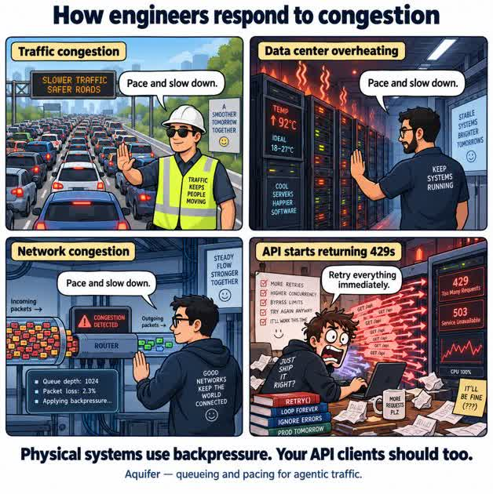
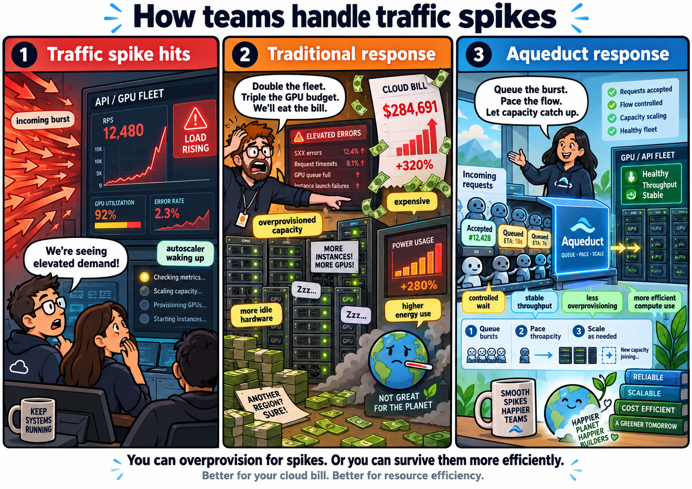
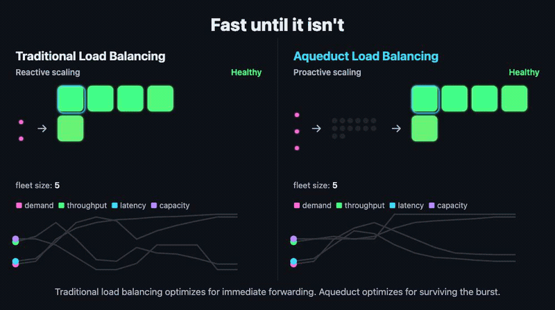

# Why Aquifer



**TL;DR — why not Hookdeck or Envoy?**

Envoy's circuit breaking protects an overloaded service by rejecting excess work, and a rejected request is gone: every client retries on its own and they compete for whatever capacity frees up. Aquifer stores the excess durably and releases it at the rate the backend says it can take right now (see [Dynamic Pacing](pacing.md)). Circuit breaking says "stop." Aquifer says "wait here, and I'll tell you when to go."

Hookdeck does something similar for inbound webhooks, as a hosted service billed by usage. Aquifer is open source and runs on your own machines like Envoy, so scaling it costs only the machines you add, and it paces outbound API calls, agent tool calls and WebSocket sessions too.

Results come back however suits the caller: synchronously on the same connection ([`POST /proxy`](../../API.md#post-proxy)), over a WebSocket that replays anything missed after a reconnect ([`GET /websocket`](../../API.md#get-websocket)), or by durable webhook.

You can run it with both: Envoy in front as the gateway, Aquifer behind it holding the work, and Hookdeck delivering its webhooks into Aquifer.

**Not going to read all this?** Point your coding agent at the [Aquifer pilot skill](../../skills/aquifer-pilot/SKILL.md). It evaluates Aquifer against your own workload in a shadow run on a branch, then shows you the numbers.

**Increase your rate limit without DDoSing your backend.**

Distributed agents call tools and APIs in bursts. Your backend gets overwhelmed on inbound. Your app gets 429s on outbound. One slow dependency takes everything else down with it, and the retries agents fire off while they wait only make it worse: [wasted utilization and higher cost](https://rahmipruitt.me/content/gpu-retry-tax/) on one end, [outages reactive autoscaling alone can't prevent](https://rahmipruitt.me/content/github-outage-reactive-scaling/) on the other.

The usual answer to that is more hardware: double the fleet, triple the GPU budget, eat the bill. It works, but it's expensive, it leaves capacity idle most of the time, and it doesn't actually fix the burst, just buys enough headroom to survive the next one:



Aquifer gives those agents a coordination layer: a self-hosted load balancer that absorbs the burst, queues requests durably (Pebble by default, or SQLite, see below), and releases them at a rate you configure, or a slower one, if the destination service asks for it.

What's usually behind that backend can't scale instantly either: a GPU, a database, a CI runner. Aquifer buys time for more of it to come online; it's overkill if that ceiling is fixed for good.

Exposed through pluggable adapters (an MCP server for agent tool-calling, a plain HTTP API, or an A2A/Agent2Agent-protocol agent), with cryptographic agent identity via the L8 protocol for trustless webhook delivery.

**Benchmarked:** 10x traffic spikes accepted with zero errors (this measures intake), 30/30 jobs surviving a `kill -9` (with per-write sync, `AQUIFER_PEBBLE_FLUSH_INTERVAL_MS=0`), and clean `429` admission shedding under sustained overload, including a real GPU under load, where a fixed rate cut peak backend queue depth from 449 to 8 waiting requests, and the ORCA fallback signal held the KV cache in a 22–79% cycle once the rate ceiling was raised past what vLLM could take. See [benchmark.md](../../benchmark.md) for throughput ceilings, crash recovery, memory behavior, capacity by machine size, and the [GPU/vLLM run](../../benchmark.md#9-gpu-inference-and-the-retry-tax-runpodvllm). Longer, end-to-end tests of Aquifer in front of real open-source systems, starting with Hatchet, are in [aqueduct-benchmarks](https://github.com/rjpruitt16/aqueduct-benchmarks).



**Terms used in these docs:** the **origin** is whoever sends a job to Aquifer: your app, an agent, a gateway, or Inlet. The **target API** is the service Aquifer sends it on to, whose capacity it protects. Some names in the code, config and headers still say "upstream" for the target API, such as `AQUIFER_MAX_PENDING_PER_UPSTREAM` and `X-Aqueduct-Upstream-URL`. They mean the same thing and keep working.

**Aquifer is not an API gateway.** It does not provide general end-user authentication, authorization policy, WAF rules, CORS policy, or arbitrary public routing. Keep it on a private network behind a trusted front door that decides who the caller is and which target is allowed. Aquifer durably queues the accepted work and controls how quickly it reaches that target.

```
API / agent callers  →  API gateway or Canalis  →  Aquifer  →  target API
webhook providers    →  Inlet                   →  Aquifer  →  webhook handlers
```

Use **[Canalis](https://github.com/rjpruitt16/canalis-rs)** as the trusted front door for API or agent traffic when you need JWT verification, sticky tenant placement, and fleet-wide capacity coordination; it can also sit behind an existing gateway. Use **[Inlet](https://github.com/rjpruitt16/inlet)** for provider webhooks: it verifies provider signatures and queues accepted deliveries into Aquifer. Aquifer is the capacity-aware load balancer behind either one: it persists jobs, enforces fairness, and paces dispatch to the target API.
