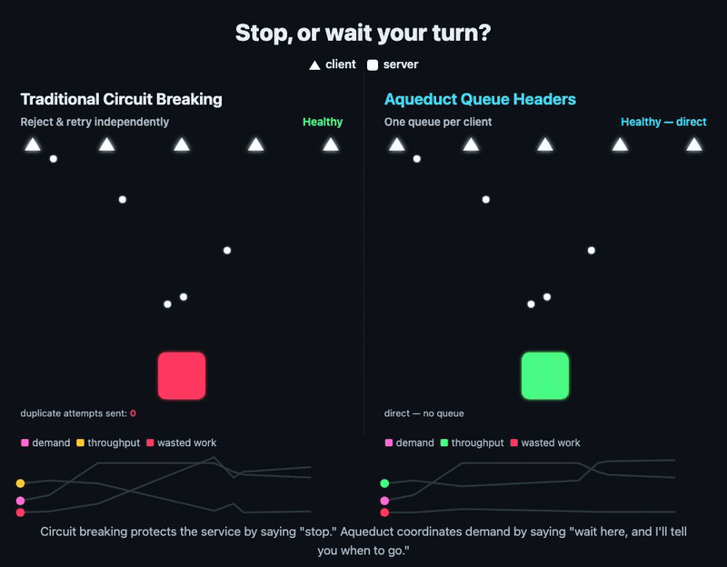

# Dynamic pacing

**Terminology**: Aquifer is this implementation; Aqueduct is the implementation-agnostic header protocol (`X-Aqueduct-*`) it speaks, so other services could speak it too.

The target API controls pace at runtime via response headers (`X-Aqueduct-Rps`, `X-Aqueduct-Max-Concurrent`, and per-tenant queue isolation), and Aquifer honors a lower pace immediately, recovering gradually once pressure clears. For backends that can't speak Aqueduct directly, Aquifer also reads the real open [ORCA](https://github.com/cncf/xds/blob/main/xds/data/orca/v3/orca_load_report.proto) standard as a fallback signal: vLLM and Triton/TensorRT-LLM both work today, verified against their actual source.

| Header (preferred)          | Alias                        | Effect                                  |
|------------------------------|-------------------------------|------------------------------------------|
| `X-Aqueduct-Rps`            | `X-Aquifer-Rps`               | Reduce dispatch rate to this value      |
| `X-Aqueduct-Max-Concurrent` | `X-Aquifer-Max-Concurrent`    | Reduce max in-flight requests           |
| `X-Aqueduct-Account-Queue`  | `X-Aquifer-Account-Queue`     | `enabled` / `disabled`: one queue per tenant, or one shared queue (has the last say) |
| `X-Aqueduct-Slow-Start`     | `X-Aquifer-Slow-Start`        | `true`: new queues ramp up instead of firing at full rate immediately |
| `X-Aqueduct-Max-Backlog`    | `X-Aquifer-Max-Backlog`       | Set the shared backlog budget used by fair admission |

Aquifer reads both namespaces, preferring `X-Aqueduct-*` when both are present.

By default each `(user_id, api_key)` pair gets its own independently paced queue at every target API, so one tenant's burst, or one tenant's broken endpoint retrying, can't slow down another: a failed attempt gives its concurrency slot back and waits out its backoff in that tenant's own queue.

Who decides, in order:

1. **The target API.** Answering with `X-Aqueduct-Account-Queue: disabled` (or `false`) puts everyone sending to it in one shared queue, for example an API that needs one global order. `enabled` (or `true`) gives everyone their own. Aquifer remembers the choice per target API.
2. **The node owner.** `AQUIFER_ACCOUNT_QUEUE=on` (the default) or `off`.
3. **The origin** (whoever sends the job), with the same header on its request, can ask for `enabled` when the node owner chose `off`, but can never turn isolation off. The mode is per target API, so one origin switching it off would take isolation away from every other tenant. Each queue's pace still stays inside the target API's actual budget: before dispatching, every tenant queue takes a slot from one shared pace per target API, set to the configured `rps` (or a pool's live capacity), so the target never sees more than that in total, however many tenants are active. The queues still take turns for those slots, so isolation never means an unbounded copy of the full rate per tenant. `max_concurrent` is still per queue: with N active tenants, up to N × `max_concurrent` requests can be in flight.

When that shared backlog crosses 70% of `X-Aqueduct-Max-Backlog`, queues holding more than their current fair share receive progressively more `429` responses while smaller queues continue entering, even once the budget is full (up to 125% of it). One active queue can still use the whole budget. See [API.md](../../API.md#fair-queue-admission) for the formula, response headers, and scope.

**Size `X-Aqueduct-Max-Backlog` in seconds of work, not as a job count.** Pick how long Aquifer should be able to hold work for the target API, at least the longest outage you want callers to ride out, and send `rate × seconds`, where `rate` is the peak rate jobs for that target API arrive at this node, across all tenants: during an outage, intake fills the budget, not dispatch. The budget is per node. A budget that's too small turns an outage into a wall of `429`s: in the [Hatchet outage benchmark](https://github.com/rjpruitt16/aqueduct-benchmarks), a 60-second budget at 20 rps (1,200 jobs) meant a 5-minute database outage refused about 25,000 submissions, and small tenants' recovery p99 was 107 s, against 3.8 s behind Envoy. A 600-second budget let the same small tenants through with no refusals at all, at a 5.5 s p99. If the advertised rate falls during an outage, keep the budget from falling with it below what Aquifer already holds; otherwise every queue is over budget at once.

A backend can lower RPS at any time via these headers when it's under pressure; Aquifer honors the lower pace immediately and recovers gradually toward the configured ceiling once pressure clears.

With `X-Aqueduct-Slow-Start: true`, a new queue starts at a low floor rate instead of its full configured rate and climbs toward that ceiling using the same gradual-recovery mechanism above, rather than firing at full speed from its very first dispatch. This applies per domain: since a queue's first-ever dispatch has no prior response to read the signal from, the setting takes effect on the *next* new queue created for that domain once any response has carried it, not the request that carried the header itself, and not retroactively for queues already running.

Use the pacing headers for intentional backpressure. A `5xx` response is treated as a failed dispatch attempt and, for pool members, lowers that member's reputation. If a service is alive but overloaded, prefer `429` and/or `X-Aqueduct-Rps` / `X-Aqueduct-Max-Concurrent` so Aquifer slows down without interpreting the member as broken.

**ORCA fallback for backends that can't speak Aqueduct directly.** Some backends already report load in a different, real open standard: ORCA (Open Request Cost Aggregation), the gRPC/Envoy ecosystem's convention for backends to report utilization. Aquifer sends `endpoint-load-metrics-format: text` on every dispatch (the request-side opt-in both verified backends require; there's no server startup flag for this), and a backend that understands it replies with an `endpoint-load-metrics` header carrying a KV-cache utilization fraction. If a response carries no `X-Aqueduct-Rps`/`X-Aquifer-Rps`, Aquifer reads this header as a fallback and paces down as utilization rises: full configured rate below 70%, 2 RPS at 70-90%, 0.5 RPS at 90-97%, 0.25 RPS above that, never dropping to zero, same pacing-down-gracefully philosophy as everywhere else. An explicit `X-Aqueduct-Rps` always wins if present; this only fires when the backend hasn't opted into speaking Aqueduct's own headers.

Two backends verified directly against their own source, not assumed: **vLLM** (`vllm/entrypoints/serve/utils/orca_metrics.py`, metric name `kv_cache_usage_perc`, case-insensitive opt-in) and **Triton/TensorRT-LLM** (`src/orca_http.cc`, metric name `kv_cache_utilization`, case-sensitive lowercase-only opt-in; Aquifer sends lowercase specifically so both work). Aquifer tries both known metric names, so whichever backend you're running, this works without any configuration.
